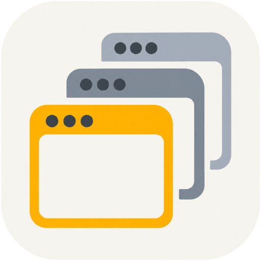

<a id="readme-top"></a>

<div align="center">



# 多會話測試瀏覽器

**每個帳號一個獨立世界 · Chrome 級瀏覽體驗 · <kbd>F12</kbd> 直達會話專屬 DevTools**

面向軟體測試人員的桌面端多帳號隔離瀏覽器——多帳號並行測試，不再 Cookie 串號、登入態互踢。


[](./LICENSE)

[简体中文](README.md) ｜ **繁體中文** ｜ [English](README.en-US.md)

</div>

---

## 🎯 為什麼需要它

多角色測試的日常：登入 A 帳號，B 帳號被踢下線；Cookie、LocalStorage 全視窗共享，資料互相污染；只能靠清快取、開無痕視窗、裝好幾個瀏覽器硬扛。

**多會話測試瀏覽器給每個會話一個完全隔離的持久化分區**——多帳號同時在線互不干擾，<kbd>F12</kbd> 隨時查看目前會話的請求與儲存，重啟之後一切如初。

| 方案                 | 多帳號同時在線 | 環境隔離    | 除錯體驗                         |
| :------------------- | :------------: | :---------- | :------------------------------- |
| 普通瀏覽器多視窗     |    ❌ 互踢     | ❌ 共享     | 無會話概念                       |
| 無痕視窗             |   ⚠️ 不持久    | ⚠️ 僅會話內 | 無會話概念                       |
| 多瀏覽器 / 多設定檔  |       ✅       | ✅          | ⚠️ 每套環境手動開 DevTools       |
| **多會話測試瀏覽器** |       ✅       | ✅ 分區級   | ✅ <kbd>F12</kbd> 與會話一一對應 |

<p align="right"><a href="#readme-top">⬆️ 返回頂部</a></p>

## ✨ 核心特性

|                              |                                                                                                     |
| :--------------------------- | :-------------------------------------------------------------------------------------------------- |
| 🧊 **會話 100% 隔離**        | 每會話獨立 Cookie、LocalStorage、快取與登入態，多帳號同時在線互不干擾                               |
| 🖥️ **Chrome 原生體驗**       | 前進 / 後退 / 重新整理 / 網址列 / 單會話多分頁，操作習慣零遷移                                      |
| 🔍 **會話專屬 DevTools**     | <kbd>F12</kbd> 喚起、<kbd>Esc</kbd> 關閉，Elements / Console / Network / Application 與會話一一對應 |
| 🗂️ **會話與工作區**          | 新增 / 刪除 / 重新命名 / 克隆 / 拖曳排序；工作區分組過濾視野，切換零資料遺失                        |
| 🌐 **會話獨立代理**          | 每會話 HTTP / SOCKS5 代理、帳號密碼認證、出口 IP 一鍵偵測                                           |
| 🔄 **Chrome 資料匯入**       | 探測本機 Chrome 設定檔，dry-run 預覽後把歷史記錄與網站資料匯入指定會話                              |
| 📸 **截圖與錄屏**            | 快速截圖（內建編輯器）與快速錄屏，成果直存本機                                                      |
| 🌗 **三態外觀 × 三套主題色** | 跟隨系統 / 白天 / 黑夜 × 琥珀 / 霧藍 / 苔綠                                                         |
| 🌍 **三語介面**              | 簡體中文 / 繁體中文 / English                                                                       |
| 💾 **全量持久化**            | 會話、工作區、頁面、設定，重啟完整恢復                                                              |

<p align="right"><a href="#readme-top">⬆️ 返回頂部</a></p>

## ⌨️ 快捷鍵

| 按鍵                        | 動作                                |
| :-------------------------- | :---------------------------------- |
| <kbd>F12</kbd>              | 喚起目前會話的 DevTools             |
| <kbd>Esc</kbd>              | 關閉 DevTools                       |
| <kbd>⌘</kbd> + <kbd>,</kbd> | 開啟設定（macOS，另有介面齒輪入口） |

## 🚀 快速開始

安裝檔將隨首個 Release 提供，目前請從原始碼執行：

```bash
git clone https://github.com/PZRvm/multi-session-browser.git
cd multi-session-browser
npm install   # 僅支援 npm
npm run dev
```

<details>
<summary><b>📦 打包</b></summary>

```bash
npm run build:win     # Windows 安裝包（x64）
npm run build:mac     # macOS 安裝包
npm run build:linux   # Linux
npm run build:unpack  # 解壓版，快速驗證打包
```

</details>

<details>
<summary><b>🏗️ 架構</b></summary>

```
src/
├── main/        # 主處理程序：視窗、IPC、會話與隔離分區管理、DevTools、匯入編排
├── preload/     # contextBridge：渲染層唯一通道 window.api
├── renderer/    # 介面層：React 19 + antd 6 + zustand
└── shared/      # i18n 字典、主題 token、跨處理程序契約
```

會話隔離基於 Electron 原生 `session.fromPartition('persist:sess-<id>')`：每個會話一個持久化分區，Cookie、快取、登入態物理隔離；DevTools 掛在會話自身的 webContents 上，與會話強綁定。

</details>

## 🧰 技術堆疊

| 層     | 技術                                             |
| :----- | :----------------------------------------------- |
| 應用殼 | Electron 39 · electron-vite 5 · electron-builder |
| 介面   | React 19 · Ant Design 6 · Zustand 5              |
| 語言   | TypeScript 5.9                                   |

## 📚 更多文件

- [PRODUCT.md](./PRODUCT.md) —— 產品事實與設計原則
- [AGENTS.md](./AGENTS.md) —— 程式碼約定與貢獻須知

## 🤝 參與貢獻

提交前請確保 `npm run typecheck` 與 `npm run lint` 通過；提交訊息遵循 [AGENTS.md](./AGENTS.md) 中的 Clean Commit 規範。

<br />

<div align="center">

**多會話測試瀏覽器幫你省下了反覆登入的時間？⭐ Star 是最好的鼓勵**

[⬆️ 返回頂部](#readme-top)

</div>
