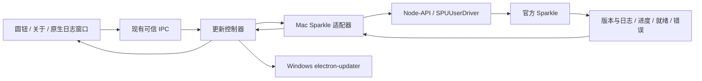

# macOS 更新迁移 Sparkle 开发计划

> 创建时间：2026-11-14 21:44:13（Asia/Shanghai）
> 更新时间：2026-11-14 23:31:27（Asia/Shanghai）
> 任务等级：L。变更 Mac 更新架构、原生依赖、安装交接和发布信任，触及共享更新契约与退出门禁。
> 分支：`feature/app-update`；基分支：`dev`；worktree：`.worktree/feature-app-update`；开发端口：`6175`。
> 实施基线：`c544a10340d07e09066b8db89f9184100412277f`（现有应用更新、版本日志与调研已提交）。
> 当前阶段：Phase 3 接入完成，Phase 4 验证进行中。33 组定向验证、arm64 / Rosetta x64 各八个最终产品隔离场景通过。R1、Intel / Windows 实机、旧系统和真实录制组合仍阻断完整门禁，尚未进入正式 Phase 5/6。
> 2026-11-15 更正：上述旧八场景只证明替换与带环境变量的手动重开，未证明自动重启成功；用户发现原生重启丢失隔离目录，完整自动重启结论撤回。[独立修复计划](2026-11-15-Sparkle测试重启隔离修复.md)补直接读取自动启动窗口的断言。旧 JSON 证据已归档到 dist/update-evidence/2026-11-14，旧应用和临时数据按用户要求清理。
> 输入：[迁移影响分析](../notes/learn/2026-11/20261114213431-Sparkle迁移影响分析.md)、[PRD 4.16](../docs/requirements/PRD.md)、[现有更新计划](2026-11-13-应用自动更新.md)、[安装确认补充计划](2026-11-14-下载完成自动确认安装.md)。

## 1. Step 0：需求简报

### 背景与用户体验

当前 Mac 更新包可下载，但临时签名应用无法通过 Squirrel.Mac 的安装验签。用户是个人开源维护者，暂不购买 Apple Developer 证书，已指定迁移 Sparkle。

迁移后，用户仍从右上角圆钮查看对应版本的日志，确认后下载；下载完成主动询问是否重启安装。点“稍后”仍保留已下载版本，普通退出不安装；2026-11-14 实测取消会清缓存，用户已确认：应用未退出时可稍后安装，普通退出安全取消，重新打开后需重新下载。安装必须先检查录制、严格保存，保存失败或超时留在原应用。EdDSA 负责更新包来源验证，首次安装未公证应用的系统限制仍需如实说明。

### 范围、排除项与数据边界

- 影响：Mac 更新引擎与退出交接、原生桥接及其构建、应用打包、EdDSA 签名、appcast、版本日志分发、本地验收工具与发布校验。
- 保留：Windows electron-updater / NSIS，现有更新快照和可信 IPC，右上角位置、主题圆钮、popover、原生日志窗口、关于页入口、构建策略和安装前保存。
- 排除：Linux 更新、付费 Apple 证书申请与公证接入、App Store、自建更新服务器、差分更新、后台自动下载、静默或普通退出安装、预发布和降级、插件更新、产品名和正式 appId 变更、Electron 升级、会话与存储重构。
- 数据：更新只替换应用包，不修改持久化 schema，不清空 userData、Cookie、历史或分区。恢复范围沿用现有持久化语义，不承诺恢复页面内存和未提交表单。
- 平台：Mac arm64 / x64；Windows x64 作回归。原生模块与测试应用按目标架构构建，不能以 arm64 的通过代替 x64。
- 开发与测试：普通 dev 和双入口隐藏时零更新请求、零原生引擎实例；真实升级只使用独立测试 appId、`MSB_USER_DATA` 和测试密钥。首个 Sparkle 版本手动安装，之后才测试 Sparkle 到 Sparkle 的升级。

### 行为约束

| 编号 | 必须满足的结果 |
| --- | --- |
| R1 | 主进程独占引擎；每个进程启动检查一次，不阻塞主窗，不增加定时轮询或 Sparkle 默认权限弹窗 |
| R2 | 检查和打开日志不下载应用包；用户点下载才开始，且日志、下载、安装绑定同一版本 |
| R3 | 下载和验签就绪后自动弹一次原生重启确认；稍后保留缓存，重试入口继续可用 |
| R4 | 稍后、关日志窗和普通退出均不安装；未获安装许可的原生回调不得引起退出 |
| R5 | 录制忙碌或状态未知时拒绝安装；严格保存失败、超时、候选失效时零安装，失败后恢复正常写入 |
| R6 | 下载损坏、签名错误、缺模块、错架构、网络失败和交接失败均可辨认；一次失败只产生一次原生反馈，主应用仍可用 |
| R7 | 正式包嵌入固定 EdDSA 公钥；CI 缺私钥、公钥不匹配或资源校验失败时拒绝发布，不依赖 Apple 付费凭据 |
| R8 | 版本 Markdown 同时驱动 Release 正文、Mac 日志资源和 Windows 更新日志，不增加第二份手写日志 |

### 设计轴

- 权限：沿用已登记壳窗口、顶层 frame、零额外参数的 IPC 校验；renderer 不接触桥接对象、feed URL、安装路径或密钥。Mac 只加载本应用打包的原生模块与框架。
- 通知：保留现有原生确认和错误框、popover 与窗口归属回退；不新增 renderer Modal / toast，不额外显示 Sparkle 标准更新 UI。系统可能要求的安装授权不能假装已消除。
- 并发：保留全局单飞和递增 revision；每个原生请求带 generation，晚到事件、旧版本回调、重复确认全部拒绝。
- 缓存与事务：ready 必须表示目标版本经过验证且可再次安装；取消后若缓存实际失效，不能继续显示 ready。用户已确认退出后重新下载；进程内稍后仍保留就绪状态。
- 发布安全：测试密钥与正式密钥隔离；公钥进应用，私钥不进源码、产物和日志。发布先完成全部资源及签名校验，再公开 draft。

## 2. Phase 1：影响与依赖

完整文件清单与候选比较见[影响分析](../notes/learn/2026-11/20261114213431-Sparkle迁移影响分析.md)。实施接缝如下：

| 模块 | 修改边界 |
| --- | --- |
| `src/main/updates.ts` | 按平台选择引擎；Mac 移除 Squirrel 监听与计时器，保留 IPC、窗口归属、确认和单次反馈 |
| `src/main/updates/macSparkle.ts`（新增） | 将原生事件转换为现有控制器动作；持有请求生命周期、候选版本和退出取消门禁 |
| `src/main/updateController.ts`、`src/main/index.ts` | 仅补必要的异步安装交接、取消与退出处理；保留保存和录制门禁 |
| `native/sparkle/`（新增） | Objective-C++ / Node-API 桥接，调用官方 Sparkle，不自写下载器、验签或安装器 |
| `src/main/updateReleaseNotes.ts`、共享类型和 preload | 复用安全日志处理及窄桥；只有实际新增语义才调整类型，新增文案按现有全部语言同步 |
| `package.json`、锁文件、`electron.vite.config.ts` | 固定原生构建工具版本、外置桥接及加载路径；Windows 不加载 Mac 模块 |
| `electron-builder.yml`、Mac 钩子与 entitlements | 框架与 `.node` 打包、plist 公钥/feed、嵌套签名；保留 UUID、本地化、摄像头与 JIT 所需配置 |
| `scripts/electron-builder-release.cjs`、`update-assets.mjs`、`release.mjs`、`release-notes.cjs`、发布工作流 | 免费签名路径、feed 与日志资源生成、精确校验、按原发布入口公开 |
| `scripts/update-test.mjs`、测试打包配置、`tools/update-test/` | Mac 两版本应用、测试 feed、隔离密钥、真实替换与退出验证；Windows 样本保留 |

现有[审阅快照的 R1](../notes/review-todo/20261113200900-应用更新本地审阅快照.md)是独立的恢复集丢失风险，本计划不顺带修复。它阻断真实用户数据安装验收、合并和发布；原型可用一次性数据验证引擎，但不能据此宣称保存链已安全。

## 3. Phase 2：设计与原生验证门槛

### 3.1 技术选型与固定输入

采用官方 Sparkle + 项目可控 Node-API 桥接，按官方协议独立实现，不引入第三方桥接代码；打包保留 SDK 完整 LICENSE。调研中的两个现成包分别存在发现即下载、保存失败仍继续重启的问题，不直接采用其默认行为。

以 [Sparkle 2.10.1 官方 Release](https://github.com/sparkle-project/Sparkle/releases/tag/2.10.1)作为首轮验证版本。2026-11-14 查询官方 Releases API：资产 `Sparkle-2.10.1.tar.xz` 的 SHA-256 为 `1a856d2a9edb8e628de88121d7be04cf0e2167f8641650b78fca00b14244cf27`。框架、headers、generate_keys、generate_appcast、sign_update 必须来自同一版本。

`build/sparkle/sdk.json` 记录版本、来源、摘要、最低编译目标和许可；下载后先验摘要再解包。原生模块以固定 Electron 45.3.0 headers 分架构显式构建，使用系统 clang / Node-API C 接口，没有新增 npm 依赖；保持 `npmRebuild: false`。SDK 框架最低 macOS 12，当前应用最低 macOS 13；桥接显式设 minos 13.0，避免默认编译成 15.0。升级 SDK / Electron 必须重验。

### 3.2 先验证 G0，再完成设计

Phase 2 原生协议验证已通过。原型位于独立工具目录，不改生产更新装配，不使用真实用户数据。测试产物与测试私钥写入已忽略的 `dist/`，证据路径可引用，密钥不可入库。

| G0 验证项 | 必须拿到的证据 |
| --- | --- |
| 可加载 | 两架构 `.node` / Sparkle.framework 能由目标 Electron 加载；错误架构、缺文件不会导致主应用崩溃 |
| 检查与日志 | 找到新版本并展示该版本日志；服务端记录中没有应用归档下载请求；关闭日志后仍无下载 |
| 显式下载 | 用户同意后才回复原生下载许可；下载、解包和签名检查完成后，才发 ready |
| 稍后与退出 | ready 后点稍后，再普通退出；确认磁盘应用仍为旧版本；进程内稍后不重下，普通退出安全取消，重开后明确重新下载，不擅自安装 |
| 保存拒绝 | 模拟录制、保存失败和保存超时，原生 installer 不获得重启许可，应用不退出 |
| 确认安装 | 保存成功后才安装，应用替换并重启到新版本；恢复测试数据不丢失 |
| 错误路径 | 错公钥、损坏归档、网络中断都不能变成 ready 或触发安装；重试不消费旧回调 |

官方 [SPUUserDriver](https://sparkle-project.org/documentation/api-reference/Protocols/SPUUserDriver.html) 说明，准备安装后的 Dismiss 仍可能随普通退出安装；该阶段 Skip 可以取消，但不能据此推定缓存必然保留。验证必须观察磁盘版本和归档请求，不能只看 UI 状态。

设计验证需要确定：检查使用 probing API 还是持有 user-driver 回复；何时启动 Sparkle installer；如何取消其退出安装；取消确认完成与缓存保留是否兼容。首轮已证明 Skip 后退出会丢失缓存：两次运行归档请求为 [1,1]，磁盘仍是 90.0.1。用户已明确接受退出后重新下载；后续依此验证，不改成随退出安装。原始未通过结果保留在 G0 证据中。

G0 通过后，将具体 API、事件顺序、退出取消结果写回本节，新增 `ADR-005-macos-sparkle-update.md` 记录架构决定。ADR-004 的主进程所有权和严格保存规则继续有效；只标注被新决定替代的 Mac 引擎部分，不将整份决定作废。

### 3.3 数据流和内部接口目标

保留 `UpdateEngine.check/download/install` 作为控制器接缝；桥接能力与方法名在 G0 后固定，不暴露给 renderer。原生层至少支持初始化、检查、针对 expectedVersion 下载、获许可后安装、取消待安装更新、清理和事件订阅。

- `check()` 在已最新、找到候选或失败时结算，不因等待用户下载许可一直占住控制器锁。
- `download()` 在目标版本校验并就绪后结算；原生下载失败、取消、模块卸载必须使 Promise 落定。不能用“已发请求”冒充完成。
- `install()` 的同步调用若不足以表达许可交接，扩展为可等待的内部结果，并同步控制器与 Windows 适配；不扩大公开 IPC。
- 原生事件包含 generation、版本、阶段及必要数值；不向 renderer 传本地路径、NSError 对象或可执行 HTML。更新回调在 Cocoa 主线程处理，JS 事件经安全队列回传，并正确释放回调引用。
- 普通退出先取消未授权的待安装更新，收到原生取消结果后再退出；取消失败时不能放行退出并触发安装。获得安装许可的退出走安装专用路径，防止普通退出取消掉已授权更新。
- 已有保存超时 15 秒语义保持：底层写入未落定时锁继续持有，不与重试并发。检查、下载和交接的计时器分别绑定本次 generation；使用可区分网络失败、超时和用户取消的结果，避免长期卡在 downloading / installing。

正常时序为：检查 → available 和对应日志 → 用户下载 → downloading → 已验证 ready → 原生重启确认 → 忙碌检查 → 严格保存 → 最终版本复核 → 发安装许可 → installing → 原生退出、替换、重启。原生错误按发生阶段映射现有错误码；签名失败必须保持 signature，不能全部显示成下载失败。

### 3.4 打包、信任与资源契约

生产配置内固定 feed URL 和 `SUPublicEDKey`，不接收网页或运行时环境传入的更新地址。Mac arm64 使用 `appcast-arm64.xml`，x64 使用 `appcast-x64.xml`；feed 的稳定入口位于应用最新 GitHub Release，归档与日志 URL 指向明确的 `vX.Y.Z` Release。

1. **包结构与顺序**：构建桥接 → 嵌入 `.node` / Sparkle.framework 及必要 helper → 注入 plist、LC_UUID 和本地化 → 按嵌套顺序完成 ad-hoc 签名 → 校验整个 app → 归档 → EdDSA 签名与 feed。最终签名后不再修改应用包。归档保留 framework 符号链接和可执行权限。
2. **系统配置**：确认 ad-hoc 下框架与 Library Validation 的关系，仅在该分发配置使用验证所需的 entitlement，不要求用户关闭系统安全功能。现有摄像头、JIT、本地化与独立 UUID 均需回归。
3. **密钥**：正式公钥作为构建输入验证并嵌入；正式私钥只从 `SPARKLE_PRIVATE_KEY` secret 进入临时签名环境，缺失或不匹配直接失败。首次生成后单独安全备份，禁止每次构建换钥。测试工具每个隔离测试集使用自己的公私钥，两版本共用；不读取正式私钥。
4. **日志**：沿用 `scripts/release-notes.cjs` 读取唯一版本 Markdown，去 frontmatter 后输出 `release-notes-vX.Y.Z.md` 附件；appcast 关联该资源，桥接将正文及版本送入现有归一化。日志读取需限长、可取消且不阻塞下载，失败显示现有缺省文案。G0 要验证检查阶段能取得日志。
5. **清单**：验证两份 feed 与各自 app 的版本、架构、归档 URL、长度、EdDSA 签名、公钥和日志引用；Windows 保持 latest.yml 的哈希与日志校验。Mac 不再依赖 latest-mac.yml / blockmap，也不把它们误列为缺失资源。
6. **发布**：保留 `dev → main` 已合并 PR 的唯一发布入口和版本门禁；所有安装包、日志、feed、校验文件在 draft 内上传且完整校验后再公开。缺一架构、签名无效或有未声明附件即失败；插件 Release 的 `--latest=false` 保留。

版本绑定保持：`package.json.version` / 锁文件 → 唯一版本 Markdown → 同版本 app、Tag 和 Release → Mac appcast / Windows latest.yml；不得覆盖已公开版本。EdDSA 签名和公钥是免费路线，未公证的首次分发限制仍写进发布说明。

## 4. Build order：按阶段实施

每步同步下面同一份 Todo List，不以文末追加记录代替当前状态。以下命令均在本 worktree 根执行。

| 顺序 | 阶段与工作 | 本步通过条件 |
| --- | --- | --- |
| 1 | Phase 2：固定 SDK 输入，建立独立打包原型，执行 G0 | 原生 API、取消与缓存语义有真实双版本证据；写回设计和 ADR 后才能接生产 |
| 2 | Phase 3：整理原生源码、显式构建脚本、SDK 校验与许可证 | 干净安装可复现两架构模块；非 Mac 不编译、不加载；原型临时代码不混入生产 |
| 3 | Phase 3：Mac 适配器与控制器 / 退出门禁接入 | 旧 Squirrel Mac 路径停用；UI 与 IPC 保留；异步错误和取消恢复可测，Windows 行为一致 |
| 4 | Phase 3：打包钩子与日志适配 | `.node` 不留在 asar 内，框架加载及签名完整；日志始终绑定候选版本；原界面不重做 |
| 5 | Phase 3：EdDSA、两架构 appcast、资源校验和 CI | 缺正式签名材料失败；ad-hoc 路线不再强制 Apple 凭据；完整资源才可公开 draft |
| 6 | Phase 4：扩展现有 Node 定向验证，更新双版本工具并做平台验收 | 下节矩阵逐项给证据；R1 未关闭或平台未验证不能标全部通过 |
| 7 | Phase 5：按 review-checklist 评审最终 diff | 检查权限、回调竞态、退出事务、签名和范围；新问题只记录，修复另开轮次 |
| 8 | Phase 6：同步现状、summary、learn、问题与索引 | 只陈述实际通过项；计划状态与未测项一致，文档索引零警告 |

Phase 3/4 内为版本绑定、迟到回调、取消退出和签名拒绝先补失败断言，再实现到通过。保留现有 25 组中仍适用的覆盖；原 Mac 强制 Apple 证书的配置断言按本次明确改变的信任契约，替换为 EdDSA 缺材料、公钥不匹配和签名拒绝断言，并记录变更原因。不得通过删掉失败场景使新引擎通过。

## 5. Test plan

| 维度 | 必测场景与判定 |
| --- | --- |
| 正常升级 | 两个 Sparkle 包发现 → 日志 → 下载 → 取消一次 → 再确认 → 保存 → 替换 → 重启；版本、URL 顺序、激活会话及隔离登录态正确 |
| 策略与权限 | 四种入口组合；普通 dev、双隐藏零 feed 请求、零原生引擎；网页、子 frame、销毁窗和额外参数不能操作更新 |
| 交互与并发 | 主窗和独立窗同时操作只下载一次、只确认一次；关闭发起窗安全回退；过期日志窗口不能下载新候选；popover 与主题样式保持 |
| 普通退出 | available、downloading、ready、稍后四阶段分别退出；磁盘仍是旧版本；ready 后退出取消，重开需重新下载；进程内稍后再次安装不重下 |
| 保存事务 | 录制中、录制状态未知、严格读写失败、超过 15 秒、期间候选失效均零安装；写入落定后才恢复或重试；原生晚到退出不能绕过门禁 |
| 信任与网络 | 错公钥、被篡改归档、截断包、无效 feed、日志失败、断网、检查/下载/交接超时；失败单次反馈，不会伪装已最新或 ready |
| 生命周期 | 回调重复/乱序、版本变化、取消后迟到事件、桥接销毁、原生初始化失败、安装请求拒绝；Promise 全部落定、正常写入恢复 |
| 发布 | 缺 key、key 不匹配、缺架构、错版本、错误 URL、日志缺失/重复/超长、签名错误和未知附件全部拒绝；Windows 清单及 Release 正文继续与单源日志一致 |
| 平台 | Mac arm64 与 x64 分别真实替换、重启；Windows x64 保持 NSIS 升级；检查 Mac UUID、本地化、摄像头与原生模块加载 |

基础检查：`npm run typecheck`、`npm run lint`、`npm run build`、`node tools/update-test/run.mjs`、`npm run book:index`、`git diff --check`。原生行为和真实替换不能用这些静态检查代替。

保留 `node scripts/update-test.mjs build` / `serve` 入口，Mac 输出改为带 Sparkle 的两个测试版本、匹配 feed 和日志；测试服务只监听 loopback，固定测试目录白名单。生产只接受 HTTPS；若本地 HTTP 需要 ATS 例外，仅注入测试打包配置。测试工具检查端口占用，不接管用户已有 6185 服务。

agent 的 UI 验证使用 `npm run dev:agent`；它只能验证界面和零请求策略，不能代替打包升级。打包验收必须显式设置独立 `MSB_USER_DATA`，结果记录磁盘版本、网络请求和恢复数据，而非只截图 ready。执行时在本计划给用户简短验收提示，不恢复独立“应用更新验收”文档。

## 6. 当前 Todo List

### 已通过

- [x] 保存现有工作：`c544a10`；本轮重跑生产构建（含双端类型检查）、25 组定向验证通过，lint 0 错误 / 316 条既有警告。这是旧引擎基线，不是 Sparkle 验收。
- [x] Step 0：迁移方向、现有交互、免费签名目标、范围和排除项已写明。
- [x] Phase 1：影响与风险分析完成，见输入调研。
- [x] Phase 2：开发计划初稿写入；这不代表 G0 或设计门禁通过。
- [x] Phase 2 / G0：独立 Cocoa、Electron 45.3.0 arm64 / Rosetta x64 各七场景通过。含 Markdown 日志、显式下载、取消周期完成再退出、进程内稍后、模拟保存拒绝、错误签名、授权后撤销及最终替换重启；`dist/sparkle-g0/{cocoa,arm64,x64}-results.json`。不等同产品真实保存与 Intel 实机验收。
- [x] Phase 2：采用 SPUUserDriver 的 found / ready 回复与 didFinishUpdateCycle 取消完成事件；授权后仍保留 ready 回复供交接撤销使用。ADR-005 已落盘；用户已接受退出后重下。
- [x] Phase 3：原生桥接、固定 SDK / headers 摘要、两架构显式编译和 SDK 许可打包；产品包中已验证加载。
- [x] Phase 3：Mac 引擎、退出取消、安装撤销、超时门禁与日志适配；Windows 保留原引擎。
- [x] Phase 3：Mac ad-hoc 打包、归档内元数据检查、官方 EdDSA 签名和两架构 feed。
- [x] Phase 3：发布资源门禁和 CI 配置已更新；Mac 不再强制 Apple 付费凭据。仅本地验证配置，未运行远程发布。
- [x] Phase 4：33 组 Node 定向验证通过，覆盖原 Windows 回归及 Mac 零加载策略、版本变化、超时取消、迟到回执与写入锁。`dist/update-tests.log`。
- [x] Phase 4：arm64 最终产品八场景通过；含网络失败重试、日志失败回退、截断包、错误签名、真实保存故障拒绝、普通退出取消、替换重启与测试 Cookie 读取。`dist/sparkle-product/4f3fafd05e/results.json`。
- [x] Phase 4：Rosetta x64 最终产品同样八场景通过，真实 preparing / installing 发布快照、90.0.2 替换重启与 Cookie 读取均有证据。`dist/sparkle-product/60c8eac8e4/results.json`。不等同 Intel 实机。
- [x] 基础检查：类型检查、正常生产构建、两架构测试包生成通过；lint 0 错误 / 316 条既有警告，book 索引 413 文档、零警告。端口占用测试拒绝启动，原 6185 服务保持存活。
- [x] 进度返写：骨架、AGENTS、PRD、ADR、DESIGN、发布说明、旧计划后续入口及阶段 summary / learn / changelog 已同步；不代表 Phase 6 收口。

### 已知失败与阻断

- [x] 原审阅 R1 于 2026-11-15 独立修复，通过真实联动回归，见[修复计划](2026-11-15-修复更新准备恢复集R1.md)。未完成的平台验收继续开放。
- [ ] 正式 EdDSA 公私钥尚未配置，本轮只使用隔离测试密钥；缺材料的正式构建会主动失败。

### 待实施与待测

- [ ] Phase 4：真实录制与状态未知组合、macOS 13/14 实际运行、完整负例矩阵剩余项。
- [ ] Phase 4：Mac arm64 全部会话恢复集和独立窗恢复验收（受 R1 阻断）。
- [ ] Phase 4：Mac Intel 实机完整升级、取消和数据恢复；Rosetta 通过不能替代。
- [ ] Phase 4：Windows x64 真实升级回归。
- [ ] Phase 5：正式审阅并记录问题；不调用已删除的独立 code-review 技能。
- [ ] Phase 6：现状文档、summary、learn、changelog、遗留问题和索引同步。

### Phase 4 已取得的产品证据

`tools/update-test/packaged-mac.mjs` 复用实际产品代码及打包钩子，只在隔离副本中更换测试 appId / feed 并重签。通过主进程检查器替代确认框点击，不替代保存或更新引擎；全程临时 profile，不接触真实数据。

- arm64：`dist/sparkle-product/4f3fafd05e/results.json`，最终 minos 13.0 产物八场景通过。真实坏签名得到 signature、零 ready；截断包得到 download；有实际会话管理器时将 sessions.json 替换为目录，严格保存失败并拒绝安装。稍后退出保持 90.0.1；重开重新下载；保存、替换、重启后实际运行 90.0.2，测试分区 Cookie 仍可读取。不代表完整 URL / 独立窗恢复验收。
- Rosetta x64：`dist/sparkle-product/60c8eac8e4/results.json`，最终 minos 13.0 产物八场景通过。探针曾因实际安装先销毁 renderer，无法取得旧 IPC 返回而失败；失败证据保留在 `dist/sparkle-product/de157cd7e4/results.json`。最终观察真实 preparing / installing 发布快照，并核对替换、重启和 Cookie，不降低断言。不等同 Intel 实机。
- 测试阶段发现并修正：坏签名 3001 与 underlying validation 3002 的分类；原生模块默认 minos 15.0；取消缓存失效后 ready 应退为 available。红测保留 `dist/cancelled-cache-red.log`，经验已返写。
- SDK minimumSystemVersion、应用声明与编译目标均进入检查；本机 macOS 15.8.1 上的通过不代表 macOS 13 / 14 实测。

### 本次隔离验收提示

两个架构的 90.0.1 / 90.0.2 测试包已生成，本次不必再次 build。已有旧脚本占用 6185，请先在原终端关闭该测试源，再在本 worktree 运行 `node scripts/update-test.mjs serve 90.0.2`。以显式 `MSB_USER_DATA` 临时目录运行 `dist/update-test/90.0.1/mac-arm64/多会话浏览器.app/Contents/MacOS/多会话浏览器`（Intel 用 mac 目录）；不要使用真实数据目录。确认日志 → 下载 → 稍后 → 普通退出仍为旧版本 → 重开重新下载 → 确认重启到 90.0.2。首个测试包必须重新打开本次 Sparkle 构建，旧 Squirrel 包不能沿旧链升级。完整会话恢复仍受 R1 阻断。

## 7. Done criteria

G0 与全部平台测试有真实证据（已确认的退出重下规则），普通退出不安装，进程内缓存可用，退出后重新下载，只有确认并保存成功才安装；错签名和缺配置无法发布；版本日志与应用、Tag、Release 一致。R1 已在独立轮次关闭，正式审阅完成；新发现的问题均记录并明确对交付的影响，阻断交付的问题解决前不标 completed。

同步 `AGENTS.md`、`book/docs/architecture/项目骨架.md`、PRD 4.16、相关 ADR、`DESIGN.md`、`.github/RELEASING.md` 与原计划状态；summary 写清免费签名边界、日志绑定、首版手动安装和平台证据。历史失败记录保留，只有被新验证覆盖的当前规范才更新。完成后 `npm run book:index` 零警告。

本计划不授权推送、合入 dev / main 或发布线上版本；这些动作按现有发布规则执行。实际执行若遇到技术无法保留已确认体验，应停在该门槛并给出具体证据，不静默降低验收标准。

### G0 接口结论（2026-11-14）

Node-API 桥接初始化回调并暴露主进程内部 check / download(expectedVersion) / install(expectedVersion) / cancel 命令；found 回复只在下载许可时消费，ready 回复在交接结束前保留以支持撤销。取消按 ready Skip、在途下载 cancellation、found Dismiss 的阶段顺序处理，并等 `updater:didFinishUpdateCycleForUpdateCheck:error:` 后才放行普通退出或恢复写入。检查所得 releaseNotesLink 由 Sparkle 读取，available 以日志结果或有界失败为结算点，避免 UI 先打开空日志。安装撤销期间拦住退出，不让原生晚到请求绕过取消。
